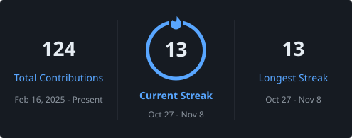

<!-- ===================== HEADER ===================== -->
<p align="center">
  
</p>

<p align="center">
  
</p>

<p align="center">
  
  
  
  
  
</p>

<!-- ===================== ABOUT ===================== -->
## 👨‍💻 About Me

```python
class SubhamSahu:
    role        = "Building smart things with AI & LLMs 🚀"
    education   = "Computer Science & Engineering student — AI & ML specialization"
    community   = "Publicity Coordinator & member, IEEE Student Branch (NIST University)"
    research    = "Working on research papers for international conferences"
    passions    = ["Artificial Intelligence", "Large Language Models", "Cloud"]

    currently   = "Contributing to open source & exploring AI/LLM technologies"
    learning    = ["LLMs", "Linux", "Git", "Open-source development", "Cloud technologies"]
    collab_on   = ["Open-source projects", "AI/LLM applications", "Developer tools"]
    need_help   = ["Open-source project architecture", "LLM engineering",
                   "Contributing to large-scale codebases"]
    ask_me      = ["Python", "Git/GitHub", "Linux", "DSA", "AI/LLM projects"]
    fun_fact    = "I enjoy solving problems, exploring open source & building with AI ⚡"
```

<!-- ===================== CONNECT ===================== -->
## 🌐 Connect with Me

<p align="center">
  <a href="https://www.linkedin.com/in/subham-sahu-58164130b" target="_blank" rel="noreferrer"></a>
  <a href="https://codeforces.com/profile/subhamsahu06" target="_blank" rel="noreferrer"></a>
  <a href="https://www.leetcode.com/subham_sahu01" target="_blank" rel="noreferrer"></a>
  <a href="mailto:subhamsahu12927@gmail.com"></a>
</p>

<!-- ===================== OPEN SOURCE ===================== -->
## 🌱 Open Source Contributions

<!-- OSS-CONTRIBUTIONS:START -->
<table>
<tr><th>Organization</th><th>Contribution</th><th>Status</th></tr>
<tr>
<td><b>OpenPrinting</b><br/><sub>The Linux Foundation</sub></td>
<td><a href="https://github.com/OpenPrinting/cpdb-libs/pull/107">cpdb-libs #107</a>: Fixed a double free of <code>service_name</code> in <code>cpdbResurrectPrinterFromFile()</code>, found and verified with Valgrind (C)</td>
<td></td>
</tr>
<tr>
<td><b>OpenPrinting</b><br/><sub>The Linux Foundation</sub></td>
<td><a href="https://github.com/OpenPrinting/cups-snap/pull/44">cups-snap #44</a>: Made the CI sandbox test print the <code>[Job ...]</code> lines of error_log, so the real cause of filter failures shows up (requested by the maintainer in #43)</td>
<td></td>
</tr>
<tr>
<td><b>OpenPrinting</b><br/><sub>The Linux Foundation</sub></td>
<td><a href="https://github.com/OpenPrinting/legacy-drivers/pull/30">legacy-drivers #30</a>: Preserved the Mitsubishi CP50 Ghostscript driver from Ghostscript 9.22, with provenance, license notes and tested build instructions (fixes #26)</td>
<td></td>
</tr>
<tr>
<td><b>OpenPrinting</b><br/><sub>The Linux Foundation</sub></td>
<td><a href="https://github.com/OpenPrinting/cups-snap/pull/43">cups-snap #43</a>: Removed echoed temporary queues from the system's CUPS, so <code>cups-proxyd</code> no longer leaves orphaned loopback queues on the host (C, fixes #39)</td>
<td></td>
</tr>
<tr>
<td><b>OpenPrinting</b><br/><sub>The Linux Foundation</sub></td>
<td><a href="https://github.com/OpenPrinting/cups-snap/pull/41">cups-snap #41</a>: Fixed truncation of long system queue names by replacing a fixed 32-byte buffer with <code>HTTP_MAX_URI</code> in <code>cups-proxyd</code> (C)</td>
<td></td>
</tr>
<tr>
<td><b>OpenPrinting</b><br/><sub>The Linux Foundation</sub></td>
<td><a href="https://github.com/OpenPrinting/legacy-drivers/pull/31">legacy-drivers #31</a>: Preserved the IBM Omni driver from Ghostscript 9.20, with provenance, license notes and build test results on 9.19 and 9.20 (fixes #27)</td>
<td></td>
</tr>
</table>
<!-- OSS-CONTRIBUTIONS:END -->

<!-- ===================== PROJECTS ===================== -->
## 🚀 Featured Projects

<table>
<tr>
<td width="33%" valign="top" align="center">

### 🔬 Sentinel Fovea 2.5D

A tactical autonomous **UGV perception & control console** with a foveated 2.5D LiDAR grid and a live dashboard.


<a href="https://github.com/subham-sahu06/sentinel-fovea-2.5d"></a>

</td>
<td width="33%" valign="top" align="center">

### 🔐 OSDAG Secure Login

Secure **login & file-access** system with a custom backend (FastAPI + PostgreSQL) and a managed backend (Appwrite).


<a href="https://github.com/subham-sahu06/osdag-secure-login-system"></a>

</td>
<td width="33%" valign="top" align="center">

### 🤖 AI Trade Manager

A Python project that applies **AI to trading workflows** to help manage and analyse trades.


<a href="https://github.com/subham-sahu06/AI-Trade-manager"></a>

</td>
</tr>
</table>

<!-- ===================== STACK & STATS ===================== -->
## 🍁 My Skill Stack
<hr/>

<h3 align="center">Languages</h3>
<hr/>
<p align="center">
  
</p>

<h3 align="center">AI, ML &amp; LLMs</h3>
<hr/>
<p align="center">
  
</p>

<p align="center"><sub>Also: ONNX · ROS 2 · currently exploring LLM application development</sub></p>

<h3 align="center">Backend &amp; Databases</h3>
<hr/>
<p align="center">
  
</p>

<h3 align="center">Linux, DevOps &amp; Tools</h3>
<hr/>
<p align="center">
  
</p>

## 📌 GitHub Overview

<p align="center">
  
</p>

<p align="center">
  
  
</p>

<p align="center">
  
</p>

## 📈 Contribution Activity

<p align="center">
  
</p>

## 📊 GitHub Analytics

<p align="center">
  
  
</p>

<p align="center">
  
  
</p>

<p align="center">
  
</p>

<p align="center">
  
</p>

<p align="center">
  
</p>

<p align="center">
  
</p>
