<!-- ===================== HEADER ===================== -->
<p align="center">
  
</p>

<p align="center">
  
</p>

<p align="center">
  
  
  
  
  
</p>

<!-- ===================== ABOUT ===================== -->
## 👨‍💻 About Me

```python
class SubhamSahu:
    role        = "Building smart things with AI & LLMs 🚀"
    education   = "Computer Science & Engineering student — AI & ML specialization"
    community   = "Publicity Coordinator & member, IEEE Student Branch (NIST University)"
    research    = "Working on research papers for international conferences"
    passions    = ["Artificial Intelligence", "Large Language Models", "Cloud"]

    currently   = "Contributing to open source & exploring AI/LLM technologies"
    learning    = ["LLMs", "Linux", "Git", "Open-source development", "Cloud technologies"]
    collab_on   = ["Open-source projects", "AI/LLM applications", "Developer tools"]
    need_help   = ["Open-source project architecture", "LLM engineering",
                   "Contributing to large-scale codebases"]
    ask_me      = ["Python", "Git/GitHub", "Linux", "DSA", "AI/LLM projects"]
    fun_fact    = "I enjoy solving problems, exploring open source & building with AI ⚡"
```

<!-- ===================== CONNECT ===================== -->
## 🌐 Connect with Me

<p align="center">
  <a href="https://www.linkedin.com/in/subham-sahu-58164130b" target="_blank" rel="noreferrer"></a>
  <a href="https://codeforces.com/profile/subhamsahu06" target="_blank" rel="noreferrer"></a>
  <a href="https://www.leetcode.com/subham_sahu01" target="_blank" rel="noreferrer"></a>
  <a href="mailto:subhamsahu12927@gmail.com"></a>
</p>

<!-- ===================== OPEN SOURCE ===================== -->
## 🌱 Open Source Contributions

<!-- OSS-CONTRIBUTIONS:START -->
<table>
<tr><th>Organization</th><th>Contribution</th><th>Status</th></tr>
<tr>
<td><b>OpenPrinting</b><br/><sub>The Linux Foundation</sub></td>
<td><a href="https://github.com/OpenPrinting/cups/pull/1829">cups #1829</a>: Fixed <code>_ppdCreateFromIPP()</code> for printers that report media sizes without a PPD name (e.g. <code>jpn_chou2</code>): a crash on 2.4.x and empty PageSize names on master. Reviewed by CUPS lead Michael Sweet (C, fixes #1828)</td>
<td></td>
</tr>
<tr>
<td><b>OpenPrinting</b><br/><sub>The Linux Foundation</sub></td>
<td><a href="https://github.com/OpenPrinting/cpdb-libs/pull/110">cpdb-libs #110</a>: Fixed printer pickles working only once: reproduced the bug, traced it to the backend's <code>replace</code> handling, and made <code>cpdbResurrectPrinterFromFile()</code> re-register with the backend, so pickles survive backend restarts (C, fixes #94)</td>
<td></td>
</tr>
<tr>
<td><b>OpenPrinting</b><br/><sub>The Linux Foundation</sub></td>
<td><a href="https://github.com/OpenPrinting/cpdb-libs/pull/107">cpdb-libs #107</a>: Fixed a double free of <code>service_name</code> in <code>cpdbResurrectPrinterFromFile()</code>, found and verified with Valgrind (C)</td>
<td></td>
</tr>
<tr>
<td><b>OpenPrinting</b><br/><sub>The Linux Foundation</sub></td>
<td><a href="https://github.com/OpenPrinting/cups-snap/pull/43">cups-snap #43</a>: Removed echoed temporary queues from the system's CUPS, so <code>cups-proxyd</code> no longer leaves orphaned loopback queues on the host (C, fixes #39)</td>
<td></td>
</tr>
<tr>
<td><b>OpenPrinting</b><br/><sub>The Linux Foundation</sub></td>
<td><a href="https://github.com/OpenPrinting/cups-snap/pull/41">cups-snap #41</a>: Fixed truncation of long system queue names by replacing a fixed 32-byte buffer with <code>HTTP_MAX_URI</code> in <code>cups-proxyd</code> (C)</td>
<td></td>
</tr>
<tr>
<td><b>OpenPrinting</b><br/><sub>The Linux Foundation</sub></td>
<td><a href="https://github.com/OpenPrinting/cpdb-libs/pull/109">cpdb-libs #109</a>: Fixed the cppcheck CI failure (<code>nullPointerOutOfMemory</code>) that broke every new PR, by checking the <code>malloc()</code> result in <code>cpdbUnpackStringArray()</code> (C)</td>
<td></td>
</tr>
<tr>
<td><b>OpenPrinting</b><br/><sub>The Linux Foundation</sub></td>
<td><a href="https://github.com/OpenPrinting/cpdb-libs/pull/108">cpdb-libs #108</a>: Jobs printed with <code>cpdbPrintFile()</code> showed up as "untitled document"; now the file name is used as the job title (C)</td>
<td></td>
</tr>
<tr>
<td><b>OpenPrinting</b><br/><sub>The Linux Foundation</sub></td>
<td><a href="https://github.com/OpenPrinting/cups-snap/pull/44">cups-snap #44</a>: Made the CI sandbox test print the <code>[Job ...]</code> lines of error_log, so the real cause of filter failures shows up (requested by the maintainer in #43)</td>
<td></td>
</tr>
<tr>
<td><b>OpenPrinting</b><br/><sub>The Linux Foundation</sub></td>
<td><a href="https://github.com/OpenPrinting/legacy-drivers/pull/30">legacy-drivers #30</a>: Preserved the Mitsubishi CP50 Ghostscript driver from Ghostscript 9.22, with provenance, license notes and tested build instructions (fixes #26)</td>
<td></td>
</tr>
<tr>
<td><b>OpenPrinting</b><br/><sub>The Linux Foundation</sub></td>
<td><a href="https://github.com/OpenPrinting/legacy-drivers/pull/31">legacy-drivers #31</a>: Preserved the IBM Omni driver from Ghostscript 9.20, with provenance, license notes and build test results on 9.19 and 9.20 (fixes #27)</td>
<td></td>
</tr>
<tr>
<td><b>OpenPrinting</b><br/><sub>The Linux Foundation</sub></td>
<td><a href="https://github.com/OpenPrinting/legacy-drivers/pull/33">legacy-drivers #33</a>: Preserved the dmprt dot matrix printer driver from Ghostscript 9.52, with provenance, license notes and build test results (fixes #25)</td>
<td></td>
</tr>
<tr>
<td><b>OpenPrinting</b><br/><sub>The Linux Foundation</sub></td>
<td><a href="https://github.com/OpenPrinting/legacy-drivers/pull/39">legacy-drivers #39</a>: Preserved the <code>xes</code>, <code>oki4w</code> and <code>ln03</code> Ghostscript contrib drivers (8 devices) from Ghostscript 10.07.1, with provenance, Foomatic PPD sources and build test results (Priority 1, first batch of #35)</td>
<td></td>
</tr>
<tr>
<td><b>OpenPrinting</b><br/><sub>The Linux Foundation</sub></td>
<td><a href="https://github.com/OpenPrinting/legacy-drivers/pull/34">legacy-drivers #34</a>: Preserved four drivers found in foomatic-db (lbp660, c2070, ml85p, lpstyl), recovered from the Wayback Machine, with provenance, license notes and build test results</td>
<td></td>
</tr>
<tr>
<td><b>OpenPrinting</b><br/><sub>The Linux Foundation</sub></td>
<td><a href="https://github.com/OpenPrinting/legacy-drivers/pull/38">legacy-drivers #38</a>: Add pentaxpj and pocketjet drivers for the Pentax PocketJet from the OpenPrinting download space</td>
<td></td>
</tr>
<tr>
<td><b>OpenPrinting</b><br/><sub>The Linux Foundation</sub></td>
<td><a href="https://github.com/OpenPrinting/legacy-drivers/pull/37">legacy-drivers #37</a>: Add dplix driver for the Dell 3010cn from the OpenPrinting download space</td>
<td></td>
</tr>
<tr>
<td><b>AuralisOS</b><br/><sub>Alpine-based Linux OS</sub></td>
<td><a href="https://github.com/Swatikantamishra8/AuralisOS/pull/6">AuralisOS #6</a>: Tested the VM ISO in QEMU/KVM and fixed 8 issues in separate commits: zram swap was never created (<code>150%: bad number</code>), <code>binfmt_misc</code> was not mounted so .exe and .dmg files never reached the router, iwd did not start, the router prompt defaulted to Yes, VirtualBox detection matched every machine, and two boot errors (Shell, Go)</td>
<td></td>
</tr>
</table>
<!-- OSS-CONTRIBUTIONS:END -->

<!-- ===================== PROJECTS ===================== -->
## 🚀 Featured Projects

<table>
<tr>
<td width="33%" valign="top" align="center">

### 🔬 Sentinel Fovea 2.5D

A tactical autonomous **UGV perception & control console** with a foveated 2.5D LiDAR grid and a live dashboard.


<a href="https://github.com/subham-sahu06/sentinel-fovea-2.5d"></a>

</td>
<td width="33%" valign="top" align="center">

### 🔐 OSDAG Secure Login

Secure **login & file-access** system with a custom backend (FastAPI + PostgreSQL) and a managed backend (Appwrite).


<a href="https://github.com/subham-sahu06/osdag-secure-login-system"></a>

</td>
<td width="33%" valign="top" align="center">

### 🤖 AI Trade Manager

A Python project that applies **AI to trading workflows** to help manage and analyse trades.


<a href="https://github.com/subham-sahu06/AI-Trade-manager"></a>

</td>
</tr>
</table>

<!-- ===================== STACK & STATS ===================== -->
## 🍁 My Skill Stack
<hr/>

<h3 align="center">Languages</h3>
<hr/>
<p align="center">
  
</p>

<h3 align="center">AI, ML &amp; LLMs</h3>
<hr/>
<p align="center">
  
</p>

<p align="center"><sub>Also: ONNX · ROS 2 · currently exploring LLM application development</sub></p>

<h3 align="center">Backend &amp; Databases</h3>
<hr/>
<p align="center">
  
</p>

<h3 align="center">Linux, DevOps &amp; Tools</h3>
<hr/>
<p align="center">
  
</p>

## 📌 GitHub Overview

<p align="center">
  
</p>

<p align="center">
  
  
</p>

<p align="center">
  
</p>

## 📈 Contribution Activity

<p align="center">
  
</p>

## 📊 GitHub Analytics

<p align="center">
  
  
</p>

<p align="center">
  
  
</p>

<p align="center">
  
</p>

<p align="center">
  
</p>

<p align="center">
  
</p>

<p align="center">
  
</p>
